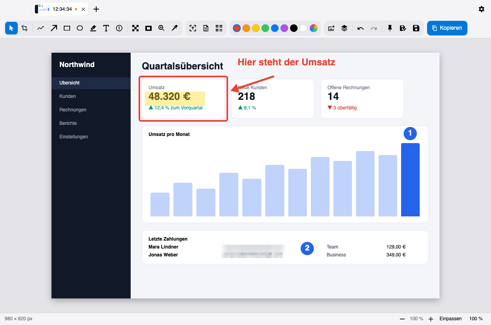
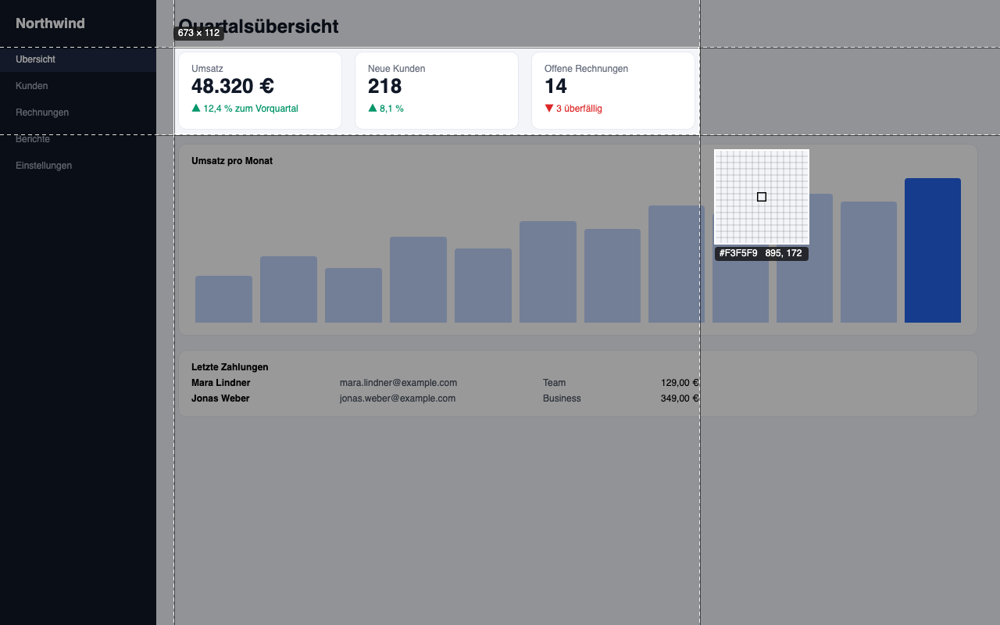
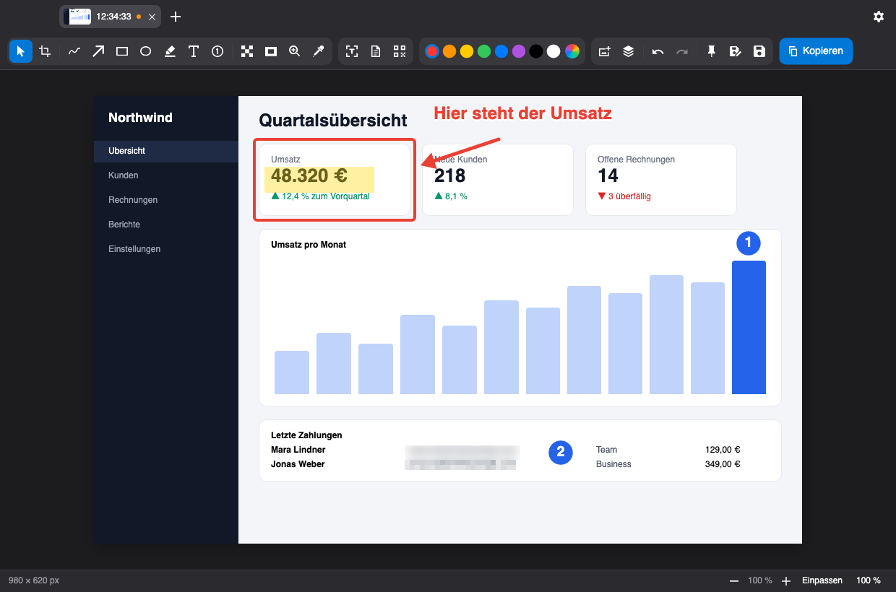
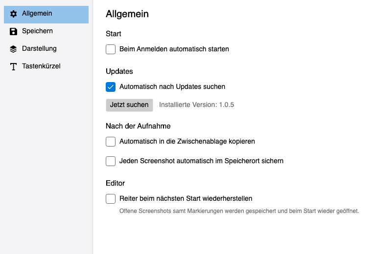
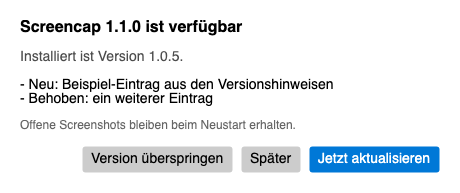

# Screencap

Screenshot-Tool nach dem Vorbild von [Shottr](https://shottr.cc) – für **macOS** und **Windows**.

**[Download](../../releases/latest)** · **[Benutzerhandbuch](docs/Benutzerhandbuch.md)** · **[Entwicklung](docs/Entwicklung.md)** · **[Changelog](CHANGELOG.md)**

<p align="center">
  
</p>

## Funktionen

- **Aufnehmen**: Bereich (⌘⇧2 / Strg+Umschalt+2) mit eingefrorenem Bildschirm und Pixel-Lupe, Fenster per Klick, Vollbild (⌘⇧1), Scroll-Aufnahme (⌘⇧6) – Kürzel frei einstellbar
- **Vorschaufenster** direkt neben dem Bereich: Bearbeiten, Kopieren, Speichern, Text erkennen, Anpinnen
- **Pins**: Screenshots schweben immer im Vordergrund, in Originalgröße, mit Zoom und Deckkraft
- **Editor mit Reitern**: Zuschneiden, Freihand (Stift, Marker, Konturstift), Lupe, Pfeil, Rechteck, Ellipse, Marker, Text mit Formatierung, Nummern mit Zeiger, Verpixeln/Verwischen (auch per Klick auf erkannte Wörter), Spotlight, Pipette, weitere Aufnahmen einfügen
- **Alles bleibt editierbar**: Griffe, Ebenen-Panel, Rückgängig/Wiederholen, Zoom; die Arbeitsfläche wächst mit herausgezogenen Elementen
- **Text- und QR-Erkennung** lokal (Apple Vision / Windows-OCR, ZXing) – global per ⌘⇧O oder im Editor
- **Teilen**: Zwischenablage (funktioniert in Mail, Office, Chat …), PNG oder JPG, automatisches Speichern, Aufräumen alter Screenshots
- Glas-Effekt, helles/dunkles Design, Werkzeug-Einstellungen werden gemerkt

## So sieht es aus

| | |
|---|---|
| **Bereich aufnehmen** – der Bildschirm friert ein, Fenster werden beim Überfahren erkannt, Hilfslinien und Pixel-Lupe helfen beim Ausrichten. |  |
| **Helles und dunkles Design** – der Editor folgt dem System. |  |
| **Einstellungen** – Autostart, Speichern, Design, Tastenkürzel und Updates. |  |
| **Updates** – Screencap sucht selbst nach neuen Versionen und installiert sie auf Wunsch mit einem Klick. |  |

Die Beispielbilder entstehen mit erfundenen Daten aus den echten Fenstern der App (siehe [Entwicklung](docs/Entwicklung.md#screenshots-für-die-github-seite)).

## Installation

Fertige Pakete gibt es unter **[Releases](../../releases)**:

| System | Datei |
|---|---|
| macOS (Apple Silicon) | `Screencap-<version>-macos-apple-silicon.dmg` |
| Windows, x64 | `Screencap-<version>-windows-x64.zip` |
| Windows, ARM64 | `Screencap-<version>-windows-arm64.zip` |

Die Pakete sind nicht notariell beglaubigt bzw. signiert – wie man sie beim ersten Start freigibt, steht im [Benutzerhandbuch](docs/Benutzerhandbuch.md#1-installation).

**Updates:** Screencap fragt beim Start und danach einmal täglich bei GitHub nach einer neueren Version und bietet sie zur Installation an. Dabei wird nur diese Abfrage an `api.github.com` gesendet, keine Nutzerdaten. Abschaltbar unter *Einstellungen → Allgemein → Updates*.

## Aus dem Quellcode bauen

Voraussetzung: [.NET 10 SDK](https://dotnet.microsoft.com/download).

```sh
dotnet build && dotnet test
./scripts/build-macos-app.sh                                            # macOS → artifacts/macos/Screencap.app
dotnet run --project src/Screencap.App -f net10.0-windows10.0.19041.0   # Windows
```

Aufbau, Besonderheiten und Release-Ablauf: [docs/Entwicklung.md](docs/Entwicklung.md).

## Lizenz

[GNU General Public License v3.0](LICENSE). Gebaut mit [Avalonia](https://avaloniaui.net) und .NET 10.
